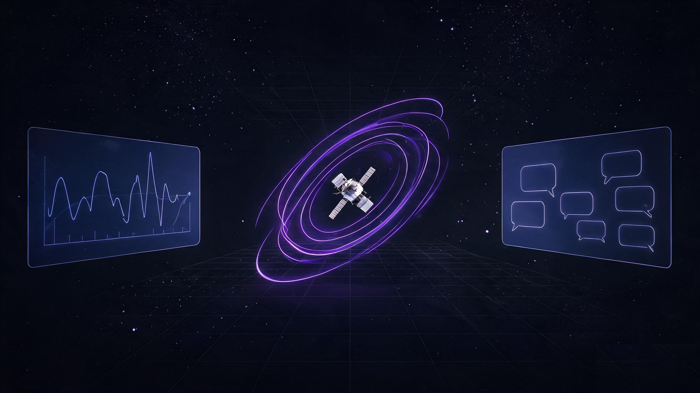
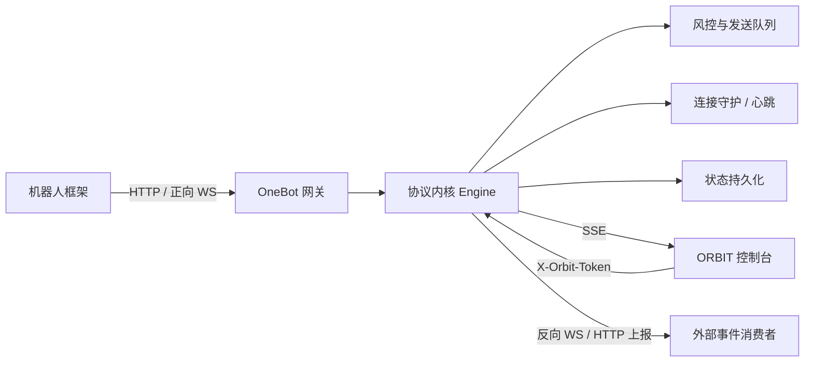

<div align="center">


# 星轨 · ORBIT

**一个原创的 QQ 协议端控制台 · OneBot 11 兼容**

不掉线，不慌张，把每一次心跳都握在手里。

[](LICENSE)
[](package.json)
[](package.json)
[](src/)
[](server/)
[](#贡献)

</div>



> 星轨不复制任何现有实现的代码，只对齐它们已经证明过的能力。
> 这是一套从零写起的协议端控制台：自己的内核、自己的风控、自己的界面。

---

## 这是什么

**ORBIT（星轨）** 是一个运行在 Node.js 上的 QQ 协议端控制台，对外提供 **OneBot 11** 标准接口，对内提供账号生命周期、连接守护、风控限流、消息工作台与可观测面板。

它适合这些人：

- 想把机器人框架接到一个稳定、可观测的协议端上；
- 想研究协议端的心跳、重连、限流与事件模型；
- 想要一个好看、能长期挂着不炸的控制台。

它**不是**：

- 不是 NapCat / SnowLuna 的代码分支，也没有包含任何第三方协议端源码；
- 不是真实 QQ 客户端，**不会连接腾讯服务器**（当前 `0.0.1-beta` 的协议内核为本地演示实现）；
- 不是一键养号的灰产工具，不提供任何绕过平台风控的能力。

---

## 特性

| 能力 | 说明 |
| --- | --- |
| 🛰️ **OneBot 11** | HTTP GET/POST、正向 WebSocket、反向 WebSocket、HTTP 事件上报 |
| 🧩 **55 个动作** | 消息、群管理、好友、资料、文件、合并转发、在线状态等常用动作已覆盖 |
| 💓 **心跳与重连** | 20s 心跳、60s 超时判定、指数退避 + 30% 抖动、watchdog 自动拉起 |
| 🛡️ **风控引擎** | 发送预算、会话冷却、内容去重、拟人化间隔、随机化发送、夜间静默 |
| 📊 **可观测面板** | 概览、账号、消息、联系人、风控、连接、API 调试、日志、设置共 9 个页面 |
| 🔐 **控制台写保护** | 写操作需 `X-Orbit-Token`，SSE 实时推送，接口分级限流 |
| 💾 **状态持久化** | 账号、群资料、设置与网络配置落盘 `data/state.json`，重启不丢 |
| 🎨 **原创界面** | Vue 3 + Tailwind v4，深色玻璃质感，零第三方 UI 套壳 |

<details>
<summary><b>展开：OneBot 动作覆盖范围</b></summary>

- **消息**：`send_private_msg`、`send_group_msg`、`send_msg`、`get_msg`、`delete_msg`、`get_forward_msg`、`get_friend_msg_history`、`get_group_msg_history`、`mark_msg_as_read`
- **账号**：`get_login_info`、`get_status`、`get_version_info`、`get_online_clients`、`get_cookies`、`get_csrf_token`、`can_send_image`、`can_send_record`
- **好友**：`get_friend_list`、`get_stranger_info`、`set_friend_remark`、`send_like`、`get_recent_contact`
- **群组**：`get_group_list`、`get_group_info`、`get_group_member_list`、`get_group_member_info`、`set_group_admin`、`set_group_card`、`set_group_name`、`set_group_special_title`、`set_group_ban`、`set_group_whole_ban`、`set_group_leave`、`set_group_kick`
- **群资料**：`get_group_notice`、`send_group_notice`、`get_group_files`、`get_group_file_system_info`、`get_group_honor_info`、`get_essence_msg_list`、`set_essence_msg`、`delete_essence_msg`
- **系统**：`get_unread_count`、`get_group_system_msg`、`get_image`、`get_record`、`get_file`

返回体遵循 OneBot 11 约定：`status` / `retcode` / `data` / `echo`。

</details>

---

## 快速开始

**环境**：Node.js ≥ 20，推荐 Node 24。

```bash
git clone https://github.com/Kei7295/XingGui-ORBIT.git
cd XingGui-ORBIT

npm install
npm run build
npm start
```

打开 **http://localhost:8787** 即可进入控制台。

### Windows 桌面版

不想装 Node？直接下载便携版压缩包：

1. 打开 [Releases](https://github.com/Kei7295/XingGui-ORBIT/releases) 下载 `XingGui-ORBIT-0.0.1-beta-win32-x64.zip`；
2. 解压后双击 `XingGui-ORBIT.exe`；
3. 数据保存在 `%APPDATA%\XingGui ORBIT\data`，卸载时删除该目录即可。

桌面版内置 Node 运行时，只监听 `127.0.0.1`，无需额外的命令窗口；首次运行若遇到 SmartScreen 提示，选择「更多信息 → 仍要运行」。

启动体验：窗口立即弹出品牌启动页，协议内核与界面并行加载，实测内核冷启动约 280ms，启动页会显示阶段与进度，就绪后无缝切换。

开机自启：桌面版菜单「文件 → 开机自启」可为当前用户注册登录时启动，无需任何脚本。

自行构建桌面版：`npm run build:win`，产物输出到 `release/`。开发调试可直接运行 `npm run desktop`。

开发模式（前端热更新 + 后端独立运行）：

```bash
npm run dev          # 前端
npm run dev:server   # 后端，端口 8787
```

### 环境变量

| 变量 | 默认值 | 作用 |
| --- | --- | --- |
| `PORT` | `8787` | 服务监听端口 |
| `ORBIT_ACCESS_TOKEN` | `orbit-demo-token` | OneBot 接口 `access_token` |
| `ORBIT_CONSOLE_TOKEN` | 启动时随机生成 | 控制台写操作令牌 |
| `ORBIT_DATA_DIR` | `./data` | 状态文件目录 |

```bash
ORBIT_ACCESS_TOKEN='你的密钥' PORT=8787 npm start
```

---

## 接入 OneBot 11

### HTTP

```bash
curl -X POST 'http://localhost:8787/onebot?access_token=orbit-demo-token' \
  -H 'Content-Type: application/json' \
  -d '{"action":"get_login_info","params":{},"echo":"hello"}'
```

也支持 `Authorization: Bearer <token>`。

### 正向 WebSocket

```text
ws://localhost:8787/onebot/ws?access_token=orbit-demo-token
```

连接后立即收到 `meta_event/lifecycle`，每 30s 收到一次 `heartbeat`；消息事件会以 `message` / `message_sent` 推送。

### 反向 WebSocket

在 **设置 → 反向 WS 与事件上报** 中填写地址并开启：

```text
ws://你的服务:端口/onebot
```

ORBIT 会主动外连，使用 `Authorization: Bearer <主密钥>`，断线后按设定间隔重连；对端可以下发动作，事件会自动回传。

### HTTP 事件上报

同一张设置卡片中开启，填写上报地址与密钥。事件以 `POST` 发送，带 `Authorization: Bearer <上报密钥>`，5s 超时，成功/失败计数实时可见。

---

## 界面

| 页面 | 你会看到什么 |
| --- | --- |
| 概览 | 在线率、延迟曲线、风险评分、实时事件流 |
| 账号 | 扫码登录流程、多账号状态、重连与掉线演练 |
| 消息 | 会话列表、消息气泡、发送队列与冷却提示 |
| 联系人 | 好友与群组、成员角色、群资料 |
| 风控 | 六条规则的开关、预算窗口、拦截记录 |
| 连接 | 心跳参数、退避曲线、端点健康度、链路时间线 |
| API 调试 | 在线构造 OneBot 请求并查看返回 |
| 日志 | 分级过滤、关键字检索、导出 |
| 设置 | 身份、行为、网络、外观与数据管理 |

---

## 真实 QQ 接入（实验）

`0.0.1-beta` 默认仍运行演示内核。协议层已改为可切换：

```bash
ORBIT_PROTOCOL=ntqq npm start
```

对应接口：

```bash
curl http://localhost:8787/api/protocol
curl -X POST http://localhost:8787/api/protocol \
  -H 'Content-Type: application/json' \
  -d '{"mode":"ntqq","uin":"10001","signerUrl":"http://127.0.0.1:8080"}'
```

当前只完成「协议层边界 + 签名服务客户端 + 前置条件检测」：

- 能力矩阵与阻塞项由 `GET /api/protocol` 返回，未满足条件时 `capabilities.login` 为 `false`；
- 签名服务按 qsign 风格 `POST /sign` 调用，签名算法本身不在本仓库内；
- **登录交换（wtlogin）、发包与真实消息收发尚未实现**，需要真实账号的登录抓包与可用签名服务才能继续并验证。

因此 `ntqq` 模式现在不会建立任何腾讯连接，也不会弹出可扫的二维码。

---

## 安全模型

- 控制台所有写接口校验 `X-Orbit-Token`，令牌由 `/api/bootstrap` 下发；
- OneBot 接口支持 query `access_token` 与 Bearer 头，两种方式等价；
- `/api` 默认 600 次/分钟，`/onebot` 默认 120 次/分钟，按来源 IP 计数；
- 反连与上报均由用户显式开启，不会默认外发数据；
- `data/` 与 `.env` 已加入 `.gitignore`，不会进入版本库。

---

## 架构



```text
server/
  engine.js      协议内核：账号、消息、风控、OneBot 动作
  server.js      HTTP/SSE/WS 网关、反向 WS、事件上报、限流
src/
  pages/         9 个控制台页面
  components/    原创组件库
  lib/           API、状态、路由、格式化
tests/           内核与接口自动化测试
docs/assets/     README 视觉资源
```

---

## 开发与测试

```bash
npm test     # 19 项自动化测试
npm run build
```

测试覆盖：消息收发、风控拦截、账号生命周期、OneBot 动作、写保护、反向 WS 事件。

---

## 路线图

- [x] OneBot 11 HTTP / 正向 WS / 反向 WS / HTTP 上报
- [x] 风控引擎与连接守护
- [x] 控制台与状态持久化
- [ ] 真实协议适配层（独立插件，需自行评估合规风险）
- [ ] 多账号并发与独立风控策略
- [ ] 插件市场与事件钩子
- [ ] Docker 镜像与一键部署

---

## 免责声明

本项目仅用于**学习、研究与自建机器人框架的联调**。请遵守所在地法律法规以及腾讯的服务条款；因使用本项目产生的任何后果由使用者自行承担。项目不提供、也不鼓励任何规避平台风控或批量养号的能力。

当前版本中的账号、消息、群组均为演示数据，协议内核不会与真实 QQ 服务器通信。

---

## 贡献

欢迎 Issue 与 PR。提交前请确保：

1. `npm test` 与 `npm run build` 通过；
2. 新能力附带测试；
3. 不引入任何第三方协议端源码或闭源二进制。

---

## 许可证

本项目采用 **[GNU AGPL v3.0](LICENSE)**（`AGPL-3.0-only`）。

你可以自由使用、修改和分发；但如果你把修改后的版本作为网络服务提供，必须向用户提供对应的完整源码。选择 AGPL 而不是 MIT，是为了让这套控制台的每一条改进都能回到社区。

---

<div align="center">


**星轨 · ORBIT** — 让心跳有迹可循。

</div>
